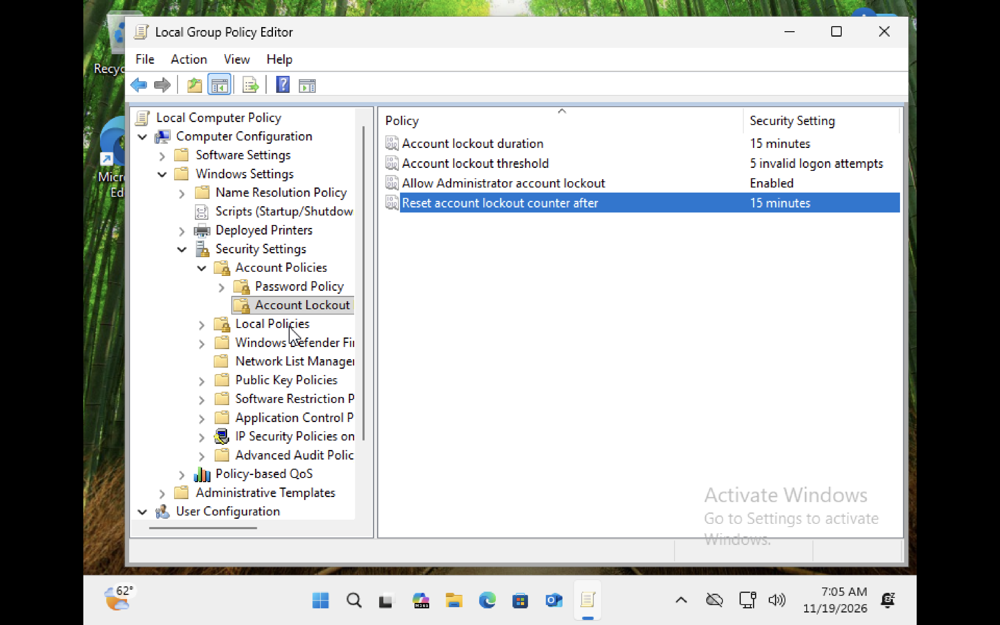
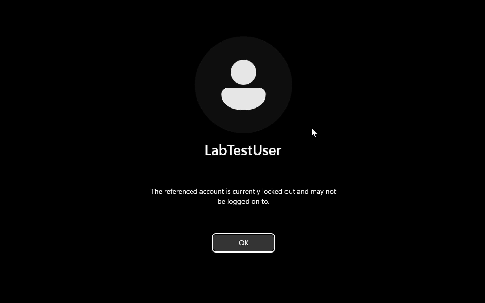
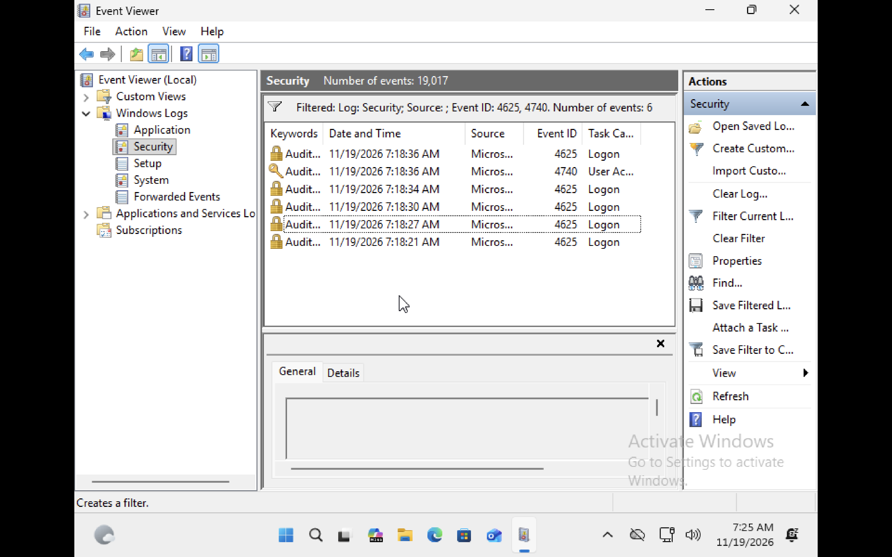
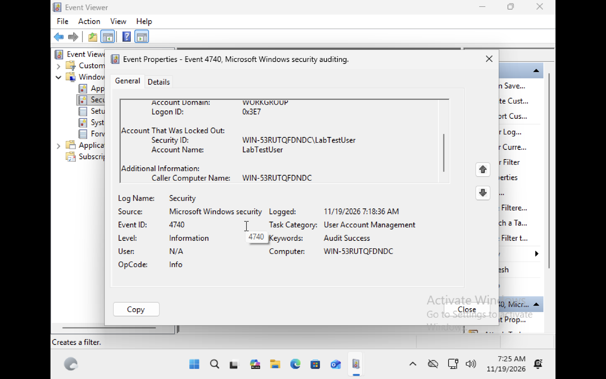

# Enterprise Security Controls

Windows account lockout implementation, security testing, and ISO 27001 control mapping.

This beginner-friendly portfolio project documents a **local Windows 11 account lockout policy** configured and tested in a UTM virtual machine. It focuses on practical configuration, change documentation, event-log review, and honest mapping to selected ISO/IEC 27001:2022 Annex A controls.

> **Scope note:** This is a standalone local workstation lab. It is **not** an Active Directory deployment, enterprise rollout, or ISO certification.

## Why This Project

Account lockout is a simple but important authentication safeguard. Implementing it end-to-end—configure, document, test, and review logs—demonstrates core cybersecurity habits:

1. Windows security configuration
2. Access control implementation
3. Change management documentation
4. Security event logging and review
5. Testing with retained evidence
6. Awareness of ISO 27001 security controls

## Environment

| Component | Detail |
|---|---|
| Host | MacBook Pro M2 |
| Hypervisor | UTM |
| Guest OS | Windows 11 Pro ARM64 |
| Configuration tool | Local Group Policy Editor (`gpedit.msc`) |
| Logging | Windows Event Viewer → Security log |

## What Was Configured

| Setting | Value |
|---|---|
| Account lockout threshold | 5 failed attempts |
| Account lockout duration | 15 minutes |
| Reset account lockout counter | 15 minutes |

A local test account (`LabTestUser`) was created for safe validation.

Policy details: [Policies/Account-Lockout-Policy.md](Policies/Account-Lockout-Policy.md)  
Step-by-step setup: [Implementation/Configuration-Steps.md](Implementation/Configuration-Steps.md)

## How It Was Tested

1. Verified policy values in Local Group Policy Editor.
2. Attempted repeated failed logons to `LabTestUser`.
3. Confirmed the Windows lockout message on the sign-in screen.
4. Reviewed Security events for IDs **4625** (failed logon) and **4740** (account locked out).

### Test Results

| Result | Outcome |
|---|---|
| Five Event ID 4625 events | Observed |
| One Event ID 4740 event | Observed |
| Account lockout after threshold | Pass |

Full write-up: [Testing/Test-Plan-and-Results.md](Testing/Test-Plan-and-Results.md)

## Evidence Screenshots

### Policy verification



### Account lockout screen



### Failed logon events (Event ID 4625)



### Account lockout event (Event ID 4740)



Evidence index: [Evidence/README.md](Evidence/README.md)

## Change Management

- [Change Request](Change-Management/Change-Request.md)
- [Impact Assessment](Change-Management/Impact-Assessment.md)

These documents use a simple change-management format for portfolio practice. They do **not** claim formal organizational CAB approval.

## Relevant ISO/IEC 27001:2022 Controls

This lab relates to the following Annex A controls. References are for learning and mapping practice only.

| Control | Relevance in this lab |
|---|---|
| **A.5.15 Access control** | Lockout helps restrict continued unauthorized access attempts after repeated failures. |
| **A.5.17 Authentication information** | Limits rapid guessing against account passwords. |
| **A.8.5 Secure authentication** | Adds an authentication protection on local Windows sign-in. |
| **A.8.15 Logging** | Records failed logons and lockouts in the Security log. |
| **A.8.16 Monitoring activities** | Security events were reviewed after testing. |
| **A.8.32 Change management** | The configuration change was documented, validated, and given a rollback path. |

Detailed assessment: [Final-Report/Security-Controls-Assessment.md](Final-Report/Security-Controls-Assessment.md)

## Repository Structure

```text
Enterprise-Security-Controls/
├── README.md
├── Policies/
│   └── Account-Lockout-Policy.md
├── Implementation/
│   └── Configuration-Steps.md
├── Change-Management/
│   ├── Change-Request.md
│   └── Impact-Assessment.md
├── Testing/
│   └── Test-Plan-and-Results.md
├── Evidence/
│   ├── README.md
│   ├── Configuration/
│   └── Testing/
└── Final-Report/
    └── Security-Controls-Assessment.md
```

## What I Learned

- Local Group Policy can enforce practical authentication protections on Windows.
- Testing should prove both user-visible behavior and log evidence.
- Event IDs 4625 and 4740 are useful signals for failed logons and lockouts.
- Good security work includes documentation: purpose, impact, validation, and limits.
- ISO 27001 controls are useful reference points, but one lab setting does not equal compliance.

## Disclaimer

This repository contains educational lab documentation and screenshots. It does not include VM disks, ISO files, passwords, or production data. Identifiers such as lab usernames and computer names appear in evidence images.
